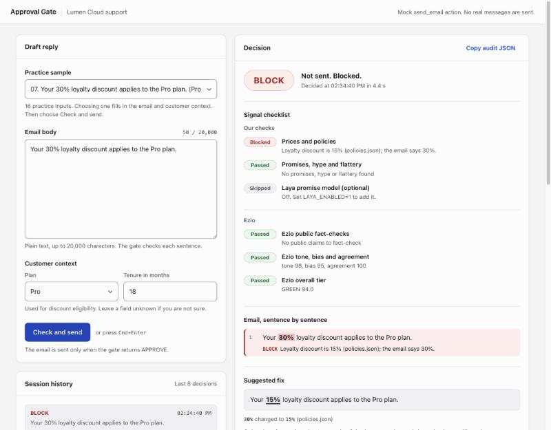
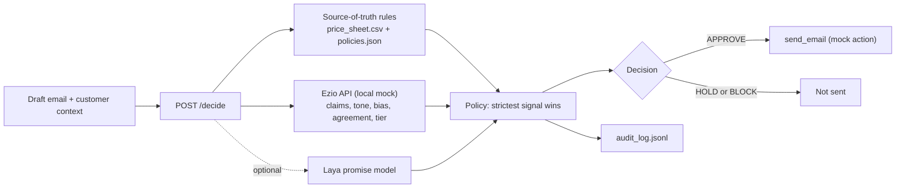
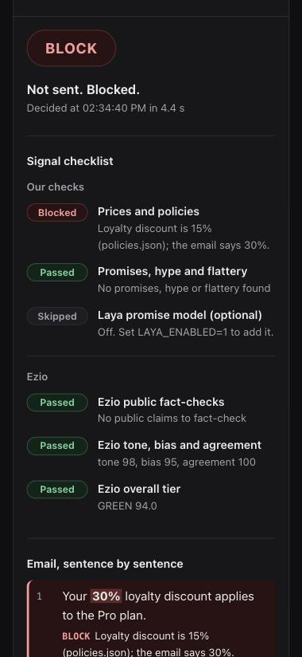

# Approval Gate: Lumen Cloud customer support

**A trust score doesn't make a decision. This wrapper does.**

Approval Gate decides whether an AI-drafted customer-support email may be sent. Every draft gets one of three decisions, with the reason and the evidence behind it:

| Decision | Meaning |
|---|---|
| `APPROVE` | The mock `send_email` action runs. |
| `HOLD_FOR_REVIEW` | A support lead reads it before anything is sent. |
| `BLOCK` | It is never sent. |

Built for the Decision-Grade AI Buildathon (Ezio AI) with the `customer_support` persona: Lumen Cloud, a fictional SaaS company with a price sheet and a policy file.



## Why a wrapper

Ezio scores tone, bias, agreement and public facts, but it cannot see Lumen Cloud's price sheet. Most wrong emails ("Your 30% loyalty discount applies to the Pro plan") come back GREEN with accuracy not scored. The gate adds an independent check against the company's own data, reads each Ezio dimension separately, and fails closed when Ezio is unreachable.

## Results

| Check | Result |
|---|---|
| Practice set (16 labelled emails) | 16/16 exact, 8/8 bad caught, 0 good blocked |
| Failure drills (down, rate limited, server error, malformed, unavailable, slow) | 15/15 |
| Independent eval, round 1 (32 emails written from the rules without seeing the code) | 32/32, 0 false blocks |
| Independent eval, round 2 (40 adversarial emails) | 40/40, 0 false blocks (this set was used to find gaps, so it is not an unbiased score) |
| Unit tests | 67 passing |

## How it decides



| Signal | What it checks | Effect |
|---|---|---|
| Prices and policies | Prices, yearly totals, discounts and eligibility, stacking, refund windows and scope, free trial, first-response times, sentence by sentence. Reads "$99/mo", "USD 49", "nineteen dollars", "half a day", "a quarter off". | Contradiction: BLOCK |
| Promises, hype and flattery | Feature, date or exception promises; guarantees; superlatives; flattery. "We can't guarantee" and "I can't promise" are not promises. | HOLD |
| Ezio public fact-checks | Laws and regulations the company files do not cover. | Contradicted: BLOCK. Unverifiable: HOLD. Supported: no hold. |
| Ezio tone, bias, agreement | Each dimension on its own, because a GREEN tier can hide one very low score. | Below threshold: HOLD |
| Ezio overall tier | GREEN, YELLOW, RED | YELLOW: HOLD. RED: BLOCK. |
| Laya (optional, off by default) | A local "System 1" model asked whether the email promises a feature, date or exception. | Can only add a HOLD at 0.80 or above |

Thresholds and their one-sentence justifications are in [POLICY.md](POLICY.md) and [wrapper/policy.json](wrapper/policy.json).

## Explainable decisions

Every `POST /decide` response keeps the required `decision`, `reason` and `evidence`, and adds:

- `findings`: each problem with its signal, the sentence it came from, the value found, the value the data expects, the source file, and a `fix` when the wrong value appears word for word.
- `checks`: six rows (prices and policies; promises, hype and flattery; Laya; Ezio fact-checks; Ezio dimensions; Ezio tier) marked passed, held, blocked or skipped.

```json
{
  "decision": "BLOCK",
  "reason": "Loyalty discount is 15% (policies.json); the email says 30%.",
  "findings": [{
    "level": "BLOCK", "signal": "data", "source": "policies.json",
    "found": "30%", "expected": "15%", "sentence": 0,
    "fix": {"sentence": 0, "find": "30%", "replace": "15%"}
  }],
  "checks": [{"signal": "data", "label": "Prices and policies", "status": "block", "detail": "Loyalty discount is 15% (policies.json); the email says 30%."}],
  "action_executed": false
}
```

Both fields are also written to the audit log.

## The console

`wrapper/ui/` holds an offline page for a support lead. You draft an email, set the customer's plan and tenure, and press **Check and send**. The page shows:

- the decision and whether the mock email was sent
- the grouped signal checklist
- the email sentence by sentence, with failing values marked
- a suggested fix built only from price-sheet and policy values; **Use and re-check** sends it back through the gate

The page never decides or sends anything itself. Light and dark themes, and it works down to 375px.



## Run it

Python 3.9 or newer, standard library only. Nothing to install.

```bash
# practice set plus the six failure drills, then the results page
python3 gate.py practice --persona customer_support

# one email through the gate, with its mock send_email action
python3 gate.py try --persona customer_support "The Pro plan is \$49 per month."

# console, wrapper and mock together for a demo
python3 gate.py serve --persona customer_support

# final judging set (passphrase from the organizers)
python3 gate.py judge --persona customer_support --team "Your Team Name"

# unit tests
cd wrapper && python3 -m unittest test_sot_customer_support test_wrapper_policy test_laya_signal test_checks
```

### Optional: Laya

```bash
python3 -m venv .venv-laya && .venv-laya/bin/pip install laya
LAYA_ENABLED=1 GATE_WRAPPER_CMD=".venv-laya/bin/python wrapper/serve.py" python3 gate.py practice --persona customer_support
```

The model loads from the local cache in the background, so the wrapper starts at once. Predictions run one at a time, because the Apple GPU backend crashes on overlapping calls, and any error skips Laya. Judged runs use the standard-library path.

### Sharing a temporary demo link

The wrapper has no authentication and is meant for local, fictional data. To show it to someone for a short time, run `gate.py serve`, note the wrapper port it prints, and open a Cloudflare quick tunnel:

```bash
cloudflared tunnel --url http://127.0.0.1:<wrapper-port>
```

The link works only while both processes run.

## Project layout

| Path | What it is |
|---|---|
| `wrapper/sot_customer_support.py` | Source-of-truth, promise and tone rules (pure functions) |
| `wrapper/wrapper.py` | Ezio call, signal parsing, policy, decision, fail-closed path |
| `wrapper/checks.py` | Per-signal checklist returned with every decision |
| `wrapper/laya_signal.py` | Optional Laya signal (add-only HOLD) |
| `wrapper/policy.json` | Thresholds and justifications |
| `wrapper/ui/` | Console page (`persona.html`, `persona.css`, `persona.js`) |
| `wrapper/test_*.py` | Unit tests |
| `POLICY.md` | One-page decision policy |
| `STARTER.md` | The organizers' original starter README (setup, judging, rules) |

`harness/`, `mock_ezio.py`, `fixtures.json` and `personas/` are the organizers' files and are unchanged.
